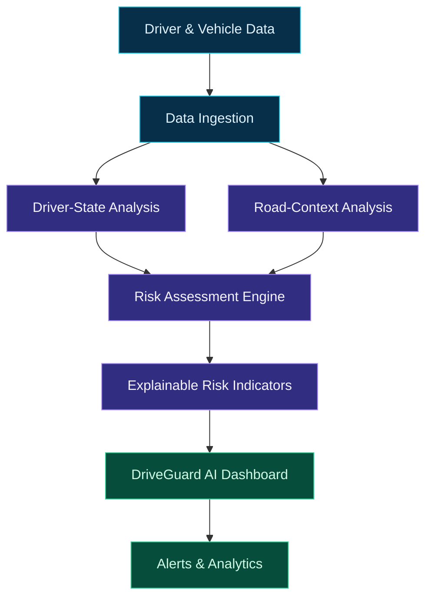

<!-- ═══════════════════════════════════════════════════════════════ -->
<!--                 DRIVEGUARD AI — README                       -->
<!-- ═══════════════════════════════════════════════════════════════ -->

<div align="center">


<br/>


<br/><br/>

<a href="https://github.com/YOUR_USERNAME/DriveGuard-AI">

</a>


<br/><br/>

**An intelligent driver-safety dashboard built to explore the intersection of AI, computer vision, vehicle telemetry, and road-risk intelligence.**

[Explore Features](#-core-systems) · [Tech Stack](#-technology-stack) · [Getting Started](#-quick-start) · [Roadmap](#-mission-roadmap)

<br/>

</div>

---

## `01 / SYSTEM OVERVIEW`

<div align="center">

<table>
<tr>
<td align="center" width="33%">

### ◈ DRIVER AI

Attention & Fatigue

</td>
<td align="center" width="33%">

### ◈ ROAD INTEL

Scene & Traffic Context

</td>
<td align="center" width="33%">

### ◈ RISK ENGINE

Risk Visualization

</td>
</tr>
</table>

</div>

DriveGuard AI is a modern driver-safety interface designed to bring driver-state indicators, road context, risk assessments, and safety analytics into one unified experience.

The goal: transform complex driving signals into understandable information that can help people investigate potential driving risks.

> **SYSTEM NOTE:** The current repository contains a frontend dashboard with demo/fallback data and API integration points. Live AI inference, real-time camera processing, and vehicle sensor integration require a configured and tested backend.

---

## `02 / CORE SYSTEMS`

<div align="center">

<table>
<tr>
<td width="50%" valign="top">

###  Driver Intelligence

Understand the signals associated with driver state.

- Attention and gaze indicators
- Drowsiness and fatigue indicators
- Distraction and phone-use indicators
- Driver posture information

</td>
<td width="50%" valign="top">

###  Road Intelligence

Visualize contextual information about driving conditions.

- Traffic and surrounding vehicles
- Lane-deviation indicators
- Speed and braking information
- Road-scene context

</td>
</tr>
<tr>
<td width="50%" valign="top">

###  Risk Intelligence

Explore risk scores and their contributing factors.

- Risk-level visualization
- Safety events and alerts
- Explainable risk indicators
- Driver-risk analytics

</td>
<td width="50%" valign="top">

###  Analytics Command Center

Turn dashboard data into readable insights.

- Historical risk trends
- Event timelines
- Interactive charts
- Demo driving scenarios

</td>
</tr>
</table>

</div>

---

## `03 / TECHNOLOGY STACK`

<div align="center">


<br/>


</div>

| Technology | Role |
|---|---|
| React + TypeScript | Component-based frontend and type safety |
| Vite | Development server and production bundling |
| Tailwind CSS | Interface styling |
| Radix UI / shadcn/ui | Reusable UI components |
| Recharts | Data visualization |
| Framer Motion | UI animations |
| TanStack React Query | API data fetching and caching |
| Lucide React | Interface icons |

---

## `04 / SYSTEM ARCHITECTURE`



<details>
<summary><b>How the intended pipeline works</b></summary>

1. Collect available driver-state, vehicle, and road-context data.
2. Analyze the signals supported by the configured data sources.
3. Combine relevant indicators into a risk assessment.
4. Present contributing factors in an explainable format.
5. Visualize alerts, metrics, and historical trends.

The diagram describes the intended architecture. It does not imply that every processing stage is already implemented or connected in the current frontend.

</details>

---

## `05 / QUICK START`

### Prerequisites

- Node.js LTS
- npm
- Git

### Installation

```bash
git clone https://github.com/YOUR_USERNAME/DriveGuard-AI.git
cd DriveGuard-AI
npm install
npm run dev
```

Open the local URL printed by Vite in your terminal.

### Production build

```bash
npm run build
```

### Project structure

```text
DriveGuard-AI/
├── public/
├── src/
│   ├── components/
│   │   └── ui/
│   ├── hooks/
│   │   └── use-driveguard.ts
│   ├── lib/
│   ├── pages/
│   ├── App.tsx
│   ├── index.css
│   └── main.tsx
├── index.html
├── package.json
├── vite.config.ts
└── README.md
```

**Standalone setup:** The extracted frontend may require workspace-specific dependencies and catalog-based package versions to be replaced with standalone npm dependencies before installation and building will work.

---

## `06 / MISSION ROADMAP`

- [x] Modern dashboard foundation
- [x] Driver-safety interface and risk visualizations
- [x] Demo/fallback data and API integration points
- [ ] Standalone dependency configuration
- [ ] Backend API integration and validation
- [ ] Real-time camera pipeline
- [ ] Computer-vision-based driver-state analysis
- [ ] Live vehicle and sensor telemetry
- [ ] Persistent safety-event history
- [ ] Automated testing and CI/CD deployment

<details>
<summary><b>Future vision</b></summary>

DriveGuard AI aims to evolve toward a modular safety-intelligence platform combining real-time observations, transparent risk indicators, configurable alerts, and historical analytics.

Any real-world safety application will require validated models, reliable sensors, privacy safeguards, and rigorous testing before operational use.

</details>

---

## `07 / DEVELOPER PROFILE`

<div align="center">


<br/><br/>


</div>

---

## `08 / CONNECT`

<div align="center">

**Designed to explore a safer, smarter driving experience.**

<a href="https://github.com/YOUR_USERNAME">

</a>

<br/><br/>


<sub>DRIVEGUARD AI · DRIVER SAFETY · RISK INTELLIGENCE</sub>

<sub>Built with curiosity, code, and a vision for safer roads.</sub>

</div>

---

### ⚠️ Disclaimer

DriveGuard AI is a development and demonstration project, not a certified automotive safety system. Demo scores and sample events are not validated real-world predictions. Do not rely on this dashboard as the sole basis for driving decisions.

</div>
