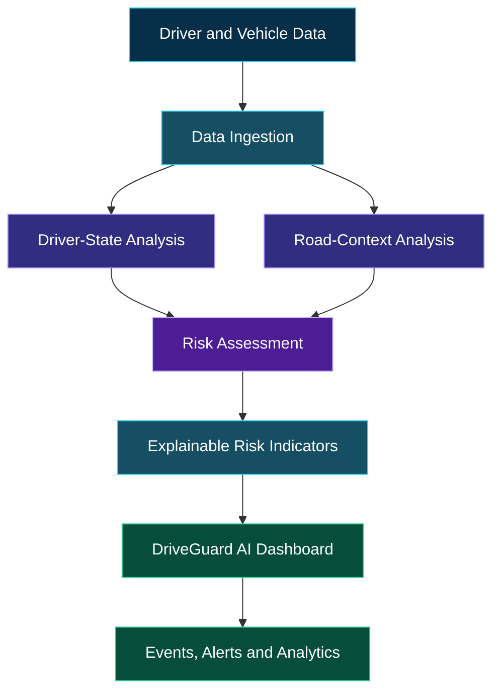

 <div align="center">


<br/>


<br/><br/>


<br/><br/>

### The future of intelligent driver safety starts here.

An AI-inspired driver-safety dashboard exploring driver-state indicators, road context, risk visualization, and driving analytics.

[ FEATURES ](#-core-systems) · [ ARCHITECTURE ](#-system-architecture) · [ INSTALLATION ](#-quick-start) · [ ROADMAP ](#-mission-roadmap)

</div>

---

## `01 / SYSTEM OVERVIEW`

> **DRIVEGUARD AI** — Turning driving signals into understandable safety insights.

DriveGuard AI is a modern web dashboard designed to visualize driver attention, potential fatigue, road conditions, vehicle behavior, and driving-risk indicators in one unified interface.

The project explores how AI-driven analysis and data visualization can help make complex driving information easier to understand.

<div align="center">

| DRIVER INTELLIGENCE | ROAD INTELLIGENCE | RISK INTELLIGENCE |
|:---:|:---:|:---:|
| Driver-state indicators | Traffic and road context | Risk scores and alerts |
| Attention and fatigue | Lane and vehicle signals | Explainable indicators |
| Monitoring interface | Driving conditions | Safety analytics |

</div>

**Current implementation:** Frontend dashboard with demo/fallback data and API integration points. Live camera inference, validated AI predictions, and real vehicle telemetry require a properly configured backend.

---

## `02 / CORE SYSTEMS`

<table>
<tr>
<td width="50%" valign="top">

### ◈ DRIVER INTELLIGENCE

Explore indicators associated with driver state.

- Attention and gaze indicators
- Fatigue and drowsiness indicators
- Distraction and phone-use indicators
- Driver posture information

</td>
<td width="50%" valign="top">

### ◈ ROAD INTELLIGENCE

Visualize driving context and surrounding conditions.

- Traffic and nearby vehicles
- Lane-deviation indicators
- Speed and braking information
- Road-scene context

</td>
</tr>
<tr>
<td width="50%" valign="top">

### ◈ RISK ENGINE

Understand the factors associated with driving risk.

- Risk scores and severity levels
- Safety-event timelines
- Contributing risk factors
- Human-readable explanations

</td>
<td width="50%" valign="top">

### ◈ ANALYTICS COMMAND CENTER

Turn driving data into visual insights.

- Historical risk trends
- Interactive data charts
- Distraction and braking events
- Demonstration driving scenarios

</td>
</tr>
</table>

---

## `03 / TECHNOLOGY STACK`

<div align="center">


<br/><br/>


</div>

| Technology | Purpose |
|---|---|
| React | Component-based user interface |
| TypeScript | Type-safe application development |
| Vite | Development server and build tooling |
| Tailwind CSS | Styling and responsive layouts |
| Radix UI / shadcn/ui | Reusable interface components |
| Recharts | Charts and visual analytics |
| Framer Motion | Interface animation |
| TanStack React Query | API data fetching and caching |
| Lucide React | Interface icons |

---

## `04 / SYSTEM ARCHITECTURE`



<details>
<summary><b>How the intended pipeline works</b></summary>

1. Collect driver-state, vehicle, and road-context information from configured data sources.
2. Analyze the signals supported by the available inputs.
3. Combine relevant factors into a risk assessment.
4. Present contributing factors and explanations.
5. Display safety indicators, events, and historical analytics.

This diagram represents the intended system design. It does not imply that all stages are implemented or connected to live data in the current frontend.

</details>

---

## `05 / QUICK START`

### Prerequisites

- Node.js LTS
- npm
- Git

### Installation

```bash
git clone https://github.com/adarshmuchatte-lang/DriveGuard-AI.git
cd DriveGuard-AI
npm install
npm run dev
```

Open the local URL printed in your terminal.

### Production build

```bash
npm run build
```

### Project structure

```text
DriveGuard-AI/
├── public/
├── src/
│   ├── components/
│   │   ├── ui/
│   │   └── error-boundary.tsx
│   ├── hooks/
│   │   └── use-driveguard.ts
│   ├── lib/
│   ├── pages/
│   ├── App.tsx
│   ├── index.css
│   └── main.tsx
├── index.html
├── package.json
├── vite.config.ts
└── README.md
```

**Setup note:** The original frontend may reference workspace-specific packages and catalog-based versions. If so, resolve those dependencies before running `npm install` in a standalone repository.

---

## `06 / MISSION ROADMAP`

- [x] Dashboard interface foundation
- [x] Driver-safety visualizations
- [x] Demo/fallback data and API integration points
- [ ] Standalone dependency configuration
- [ ] Backend API integration and validation
- [ ] Real-time camera processing
- [ ] Computer-vision-based driver-state analysis
- [ ] Live vehicle and sensor telemetry
- [ ] Persistent safety-event storage
- [ ] Automated testing and continuous deployment

---

## `07 / DEVELOPER PROFILE`

<div align="center">


<br/><br/>


</div>

---

## `08 / CONNECT`

<div align="center">

### BUILT WITH CURIOSITY. DESIGNED FOR A SAFER FUTURE.

<a href="https://github.com/adarshmuchatte-lang">

</a>

<br/><br/>


<sub>DRIVEGUARD AI · DRIVER SAFETY · RISK INTELLIGENCE</sub>

</div>

---

### ⚠️ Safety Disclaimer

DriveGuard AI is a development and demonstration project, not a certified automotive safety system. Demo scores and sample events are not validated real-world predictions. Do not rely on this dashboard as the sole basis for driving decisions.
